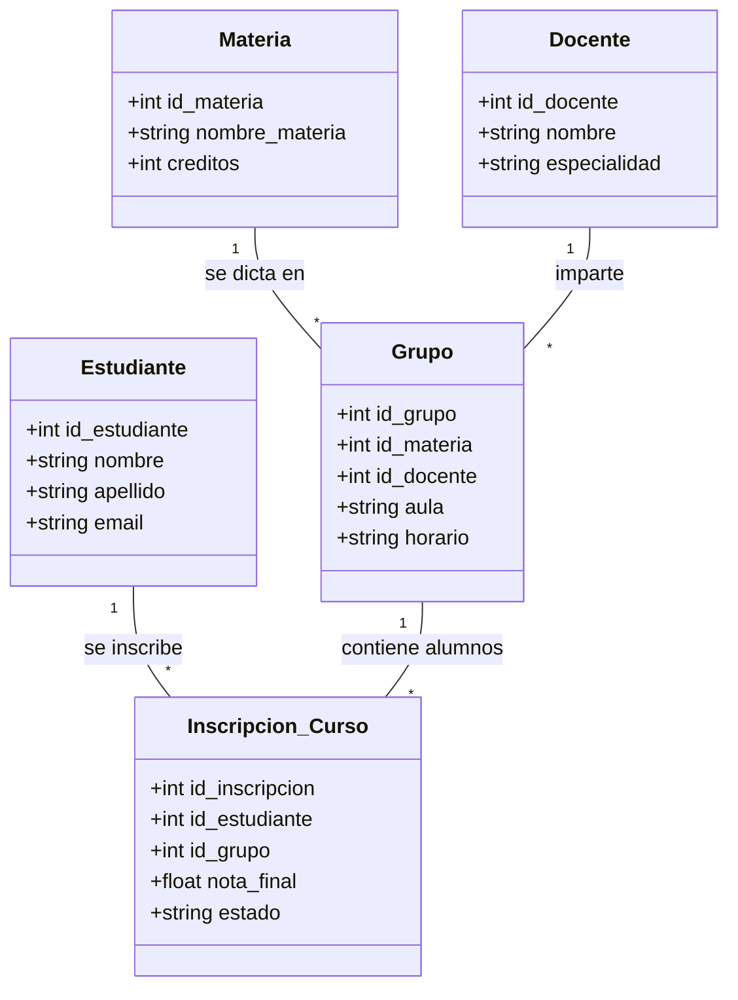
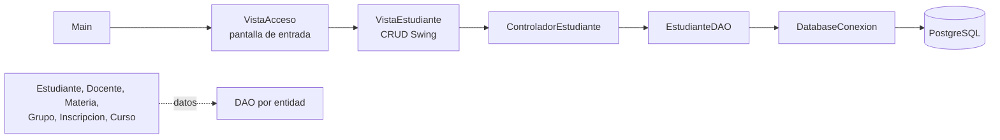

# PRÁCTICA ACADÉMICA - SISTEMA DE GESTIÓN UNIAJC (MVC + DB)

## Objetivo
Replicar el ecosistema académico propuesto en el diagrama Mermaid, siguiendo los estándares de arquitectura en capas (Entidad, DAO, Service, Controller, Vista).

## Diagrama del Ecosistema

## Mapeo de la aplicación

La aplicación es de escritorio y usa **Java 17, Swing, JDBC y PostgreSQL**. Su punto de entrada es `com.uniajc.Main`.

### Estado por capa

| Parte | Implementación actual |
|---|---|
| Entrada | `Main` abre la pantalla `VistaAcceso`. |
| Vista | `VistaAcceso` presenta el acceso; `VistaEstudiante` contiene el CRUD Swing. |
| Controlador | `ControladorEstudiante` coordina las acciones del CRUD de estudiantes. |
| Modelo y persistencia | Entidades y DAO para estudiante, docente, materia, grupo, inscripción y curso. |
| Base de datos | `DatabaseConexion` carga `config.properties`; el CRUD usa PostgreSQL. |

El acceso visual es actualmente de **demostración**: comprueba que ambos campos tengan contenido, pero no valida usuarios ni contraseñas contra una tabla o servicio. El flujo funcional conectado a la base de datos es el CRUD de estudiantes; las demás entidades aún no están conectadas a pantallas/controladores.

## Instrucciones para el Estudiante:
1.  **Crea tu propia rama:** `feature/practica-[TuNombre]`.
2.  **Entidad:** Crea las clases en el paquete `com.uniajc.modelo` para las entidades restantes.
3.  **DAO:** Implementa la persistencia en `com.uniajc.modelo` usando JDBC y `ConexionDatabase`.
4.  **Servicio:** Agrega la lógica de negocio (validaciones de integridad).
5.  **Vistas:** Implementa interfaces tanto para Scanner como para SWING como para JAVA FX.
6.  **Pruebas:** Asegúrate de que tu código pase los tests de validación del docente.

## Configuración de BD:
Usa `config.properties` en la raíz del proyecto. La conexión acepta `db.url`, `db.user` y `db.password`,
o sus alias `URL`, `USERNAME` y `PASSWORD`. El archivo está ignorado por Git; conserva allí las
credenciales y reinicia la aplicación después de cambiarlas. No subas ese archivo al repositorio.

La base configurada debe tener la tabla `public.estudiante` con `id`, `name`, `lastname`, `email`, `nit`
y `numcelular`. Ejecuta [`src/main/resources/db/estudiantes.sql`](src/main/resources/db/estudiantes.sql) para instalar
las rutinas usadas por el CRUD: `sp_insertar_estudiante` (crear), `fn_listar_estudiantes` (listar),
`sp_actualizar_estudiante` (editar) y `sp_eliminar_estudiante` (eliminar). Luego inicia la aplicación desde
tu IDE usando `com.uniajc.Main`.

---
*Recuerda: El Modelo nunca debe hablar con el usuario (sin System.out). El Controlador orquesta y la Vista interactúa.*

Creado para una prueba.
